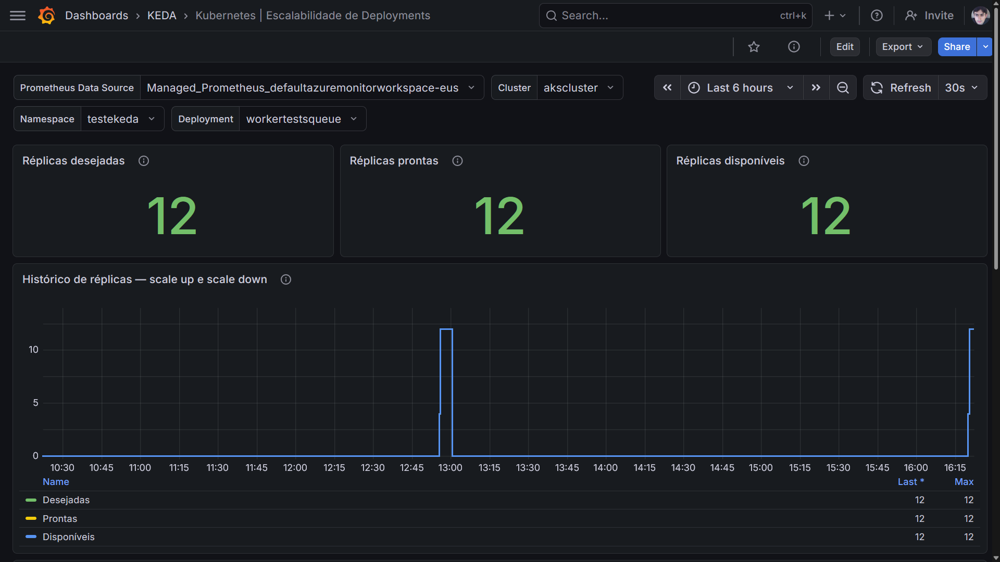
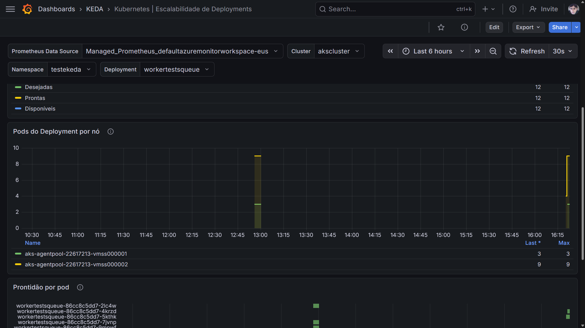
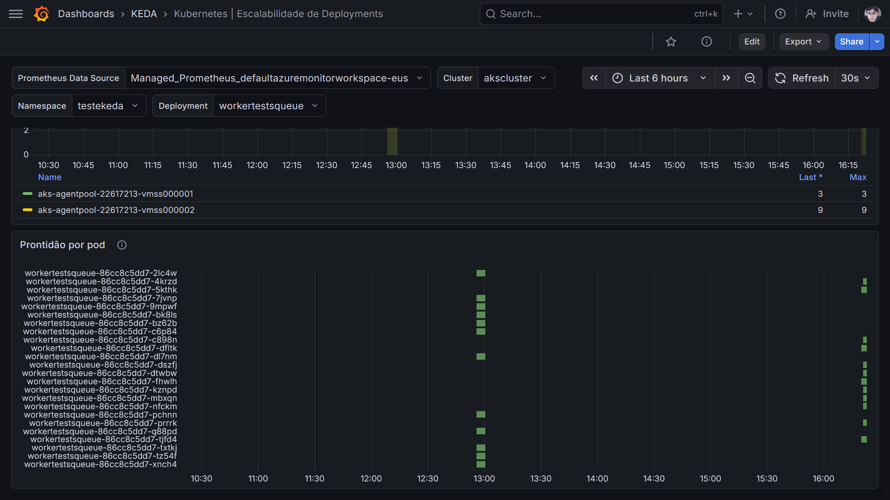

# grafana-dashboard-keda-deployments-scalability
Dashboard do Grafana para analisar a escalabilidade de deployments em Kubernetes utilizando o projeto KEDA.

Há instruções na documentação oficial do KEDA abordando o suporte a Prometheus, com métricas disponíveis e até um dashboard oficial para acompanhamento via Grafana: **https://keda.sh/docs/2.21/integrations/prometheus/**

As definições deste dashboard estão no GitHub: **https://github.com/kedacore/keda/blob/main/config/grafana/keda-dashboard.json**

Guia sobre como exportar métricas do KEDA para o Azure Managed Prometheus: **https://github.com/renatogroffe/keda_operator-aks-managed_prometheus**

Testes com este dashboard no Grafana:

